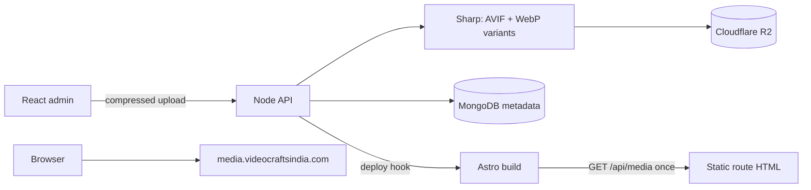

# Videocrafts India

SEO-first photography website with an **Astro public site**, a **separate React admin**, and a **separate Node.js API**.

| Part | Stack | Development | Production |
| --- | --- | --- | --- |
| Public website | Astro 7, React 19 islands, Tailwind CSS 4 | `http://127.0.0.1:5173` | `https://www.videocraftsindia.com/` |
| Admin | React 19, Vite, Lucide icons | `http://127.0.0.1:5174/admin/` | `https://admin.videocraftsindia.com/` |
| API | Node.js, Express, MongoDB, Sharp | `http://127.0.0.1:4691` | `https://api.videocraftsindia.com/` |
| Media | Cloudflare R2, custom CDN domain | local disk fallback | `https://media.videocraftsindia.com/` |

The public build generates complete route-specific HTML, metadata, JSON-LD, sitemap files and a real 404. React is shipped only for the navbar, footer and the pages that need carousels or forms. Visitors do not call `/api/media`; published media is read once during `astro build` and embedded into the generated pages.

## Repository layout

```text
client/   Astro public site, React islands, SEO metadata and build checks
admin/    Independent React image-management application
server/   Express API, authentication, MongoDB and image processing/storage
shared/   Generated editable-image catalog and source dimensions
```

## Local setup

Use Node.js 24 or newer. Start MongoDB locally or configure `server/.env` with another `MONGODB_URI`.

```sh
npm ci
npm ci --prefix client
npm ci --prefix admin
npm ci --prefix server
npm run build:all
npm --prefix server run admin:create
```

Run the applications separately:

```sh
npm --prefix server run dev
npm --prefix client run dev
npm --prefix admin run dev
```

No default admin credentials or public registration are enabled. `admin:create` asks for the email and a 14–128 character password in the terminal. The optional one-time Postman setup route is documented in [server/README.md](server/README.md).

## Media publishing flow



1. The admin accepts JPEG, PNG or WebP source files up to 50 MB and compresses them before upload.
2. The API validates the decoded image, strips metadata and generates responsive AVIF and WebP files at upload time.
3. Production variants are stored in R2 with versioned names and `Cache-Control: public, max-age=31536000, immutable`.
4. MongoDB stores the media manifest, dimensions, alt text and version history.
5. `SITE_REBUILD_WEBHOOK` queues a public deployment after publishing.
6. The Astro build reads `MEDIA_MANIFEST_URL` once and puts the selected URLs, dimensions, alt text and social images in the generated HTML.

This removes per-visitor media-manifest requests and runtime image transformations. Browsers still request image files normally, but immutable browser/CDN caching prevents repeated origin work.

### Migrate existing ImageKit originals to R2

Configure the R2 variables in `server/.env`, then run:

```sh
npm --prefix server run media:migrate:r2
```

The command is resumable: entries already using `MEDIA_PUBLIC_ORIGIN` are skipped. After migration, rebuild the public site with:

```sh
MEDIA_MANIFEST_URL=https://api.videocraftsindia.com/api/media npm --prefix client run build
```

Do not remove the ImageKit account until every catalog entry appears on the media custom domain and the production build has been deployed and verified.

## Production deployment

### Public site

Build and publish `client/build/`. `netlify.toml` includes the production media-manifest URL. Cloudflare Pages can use the same command and directory:

```sh
npm ci --prefix client
npm --prefix client run build
```

The build produces 42 indexable routes, `404.html`, web and image sitemaps, `robots.txt`, canonical redirect rules and immutable hashed assets. Configure the apex domain to redirect permanently to `https://www.videocraftsindia.com`.

### Admin

Build and publish `admin/dist/` at `https://admin.videocraftsindia.com/`. It is blocked from indexing through robots metadata and response headers.

### API and media

Deploy the complete `server/` directory at `https://api.videocraftsindia.com/`. Configure MongoDB, the exact allowed origins, R2 credentials, `MEDIA_PUBLIC_ORIGIN`, and a deployment hook. The API can run without either frontend source tree.

See [server/.env.example](server/.env.example) and [server/README.md](server/README.md) for the complete environment and operations guide.

## SEO architecture

- One generated HTML document per canonical route
- Unique titles, descriptions, canonical URLs and Open Graph/Twitter metadata
- `LocalBusiness`, `WebSite`, page-specific `WebPage`, `Service`, `Article`, `FAQPage` and breadcrumb structured data
- Native Astro sitemap generation, an image sitemap and a non-indexable 404
- Responsive images with intrinsic dimensions, AVIF/WebP variants, `srcset` and `sizes`
- Minimal route JavaScript through Astro islands
- Canonical redirects for case, trailing slashes, `.html` aliases and historical misspellings
- Long-lived caching for hashed code and immutable media
- Accessible headings, skip navigation, forms, controls and alt text

Technology makes the site crawlable and fast; rankings still depend on original service/location content, portfolio case studies, reviews, Google Business Profile quality, citations and relevant backlinks.

See [SEO_OPERATIONS.md](SEO_OPERATIONS.md) for Search Console, analytics, Google Business Profile, real-story publishing and ethical outreach steps that require production access or verified source material.

## Verification

```sh
npm run lint
npm run build:all
npm run test:all
npm run audit:production # after deployment
npm audit --audit-level=moderate
npm audit --prefix client --audit-level=moderate
npm audit --prefix admin --audit-level=moderate
npm audit --prefix server --audit-level=moderate
```

The client build check parses every generated page, validates one H1, metadata, structured data, registered images, internal links, sitemap entries, JS size budgets, redirects and 404 behavior. Server tests use an isolated temporary MongoDB database and synthetic images.
